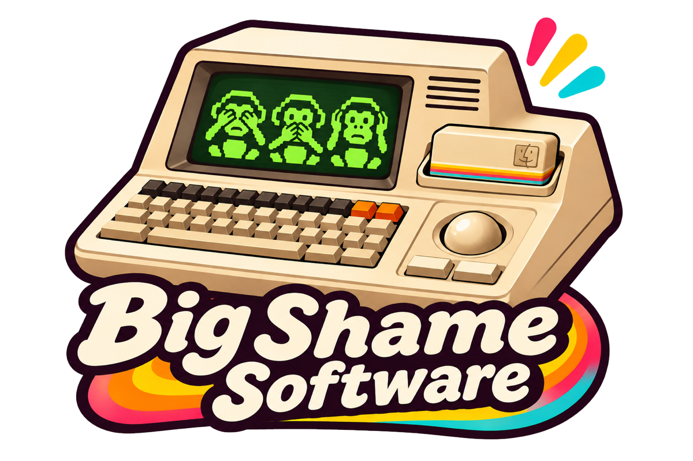

Big Shame Software makes small Mac utilities that each do one job, and gives them away. The name is a joke. The software is meant seriously, which may be the funnier part.

I should mention how we ship: **source only**. There are no downloads to double-click, so you'll need Xcode to build each app, and every repo explains how. Everything here is public domain.

## Apps

| App | What it does |
| --- | --- |
| [BestImage](https://github.com/Big-Shame-Software/BestImage) | Scores image files with Apple Vision's aesthetics score and renames them so Finder sorts the best first. |

## How these are made

These apps are written mostly with Claude, with some consulting from ChatGPT and occasional help from Gemini or an on-device Qwen model. No Grok is used. The words on these pages are drafted by Mr. Barker, an AI writing voice, and checked by a person at Big Shame before they go up.

If something here is wrong, please open an issue on that app's repo. We'd rather know.

N©! Big Shame Software. Everything here is public domain.
